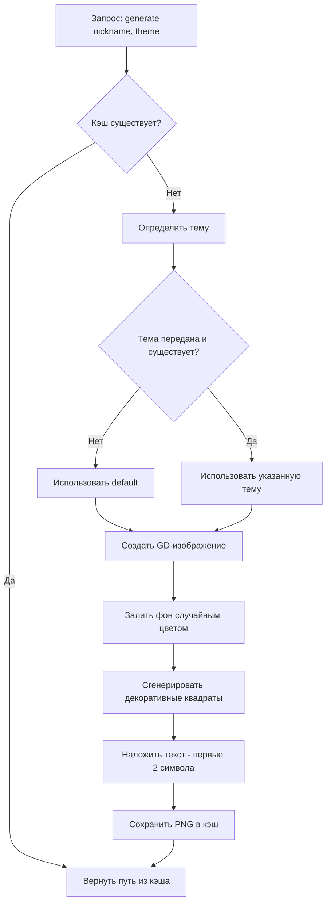
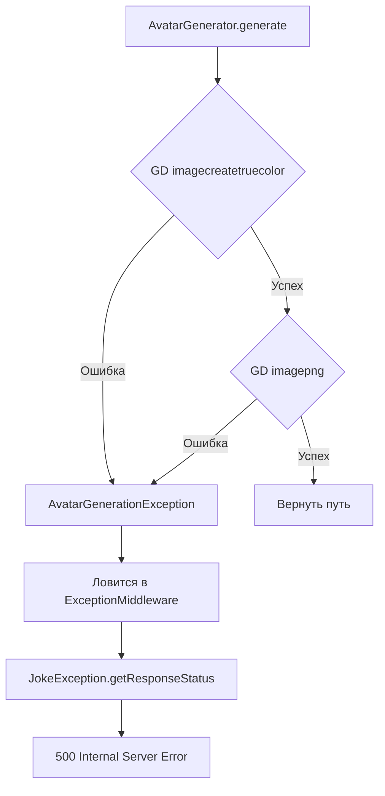

# План архитектуры модуля генерации аватаров для фреймворка Joke

## 1. Обзор архитектуры

Модуль будет оформлен как отдельный Composer-пакет с пространством имён `Vasoft\JokeAvatar`. Он интегрируется в фреймворк Joke через стандартные механизмы: сервис-провайдер и конфигурацию.

```
joke-avatar/
├── bootstrap/
│   └── kernel.php              # Конфигурация ядра для локального тестирования
├── config/
│   └── avatar.php               # Файл конфигурации модуля (eager)
├── public/
│   └── index.php                # Точка входа для локального тестирования
├── routes/
│   └── web.php                  # Маршруты для локального тестирования
├── src/
│   ├── AvatarConfig.php         # Конфигурация модуля (наследник AbstractConfig)
│   ├── AvatarException.php      # Базовое исключение модуля (наследник JokeException)
│   ├── AvatarGenerationException.php # Исключение при ошибках GD
│   ├── AvatarGenerator.php      # Сервис генерации аватаров (бизнес-логика)
│   ├── AvatarProvider.php       # Сервис-провайдер (наследник AbstractProvider)
│   └── ThemeConfig.php          # Value Object для темы оформления
├── var/
│   └── cache/
│       └── avatars/             # Директория кэша аватаров
├── composer.json
├── .gitignore
├── .gitattributes
├── README.md
└── TODO.md
```

## 2. Компоненты модуля

### 2.1. AvatarConfig (конфигурация)

**Наследует:** `Vasoft\Joke\Config\AbstractConfig`

Хранит настройки модуля:
- `size` (int) — размер аватара в пикселях (по умолчанию 200)
- `themes` (array) — массив тем, где ключ — название темы, значение — массив параметров

**Структура темы:**
```php
[
    'default' => [
        'background_colors' => ['#E8F4F8', '#F0E6F6', '#E6F0FA', '#FFF3E0', '#F3E5F5'],
        'text_color'        => '#2C3E50',
        'decorative_colors' => ['#BBDEFB', '#C8E6C9', '#FFE0B2', '#E1BEE7', '#B2EBF2'],
        'decorative_min'    => 3,   // минимальное кол-во декоративных квадратов
        'decorative_max'    => 8,   // максимальное кол-во декоративных квадратов
        'decorative_size_min' => 10, // минимальный размер декоративного квадрата (% от размера аватара)
        'decorative_size_max' => 30, // максимальный размер декоративного квадрата (% от размера аватара)
    ],
    // ... другие темы
]
```

### 2.2. ThemeConfig (Value Object)

Immutable-объект, представляющий одну тему. Содержит:
- Массив цветов фона
- Цвет текста
- Массив цветов для декоративных квадратов
- Диапазон количества декоративных квадратов
- Диапазон размеров декоративных квадратов

### 2.3. AvatarGenerator (сервис)

**Бизнес-логика генерации аватара.**

Методы:
- `generate(string $nickname, ?string $theme = null): string` — генерирует аватар, возвращает путь к PNG-файлу

**Алгоритм генерации:**
1. Проверить кэш — если аватар для данного никнейма+темы уже существует и не устарел, вернуть путь из кэша
2. Определить тему (если не передана или неизвестна — использовать 'default')
3. Создать GD-изображение (квадрат заданного размера)
4. Выбрать случайный цвет фона из массива темы
5. Залить фон
6. Сгенерировать случайное количество (в диапазоне темы) декоративных квадратов:
   - Случайный размер в диапазоне темы
   - Случайная позиция
   - Случайный цвет из массива декоративных цветов темы
7. Наложить текст (первые 2 символа никнейма) цветом из темы
   - Центрировать по горизонтали и вертикали
   - Размер шрифта подбирается пропорционально размеру аватара
8. Сохранить PNG в кэш
9. Вернуть путь к файлу

**Обработка ошибок GD:**
- Все ошибки GD оборачиваются в `AvatarGenerationException`
- Проверка доступной памяти перед созданием большого изображения

### 2.4. AvatarProvider (сервис-провайдер)

**Наследует:** `Vasoft\Joke\Provider\AbstractProvider`
**Реализует:** `Vasoft\Joke\Contract\Provider\ConfigurableServiceProviderInterface`

- `register()` — регистрирует `AvatarGenerator` в контейнере как синглтон
- `provides()` — возвращает `[AvatarGenerator::class]`
- `provideConfigs()` — возвращает `[AvatarConfig::class]`
- `buildConfig()` — создаёт `AvatarConfig` со значениями по умолчанию

### 2.5. Исключения

```
Vasoft\Joke\Exceptions\JokeException
    └── Vasoft\JokeAvatar\AvatarException          # Базовое исключение модуля
        └── Vasoft\JokeAvatar\AvatarGenerationException  # Ошибки GD
```

### 2.6. Кэширование

- Директория кэша: `<корень_проекта>/var/cache/avatars/`
- Формат имени файла: `md5(<никнейм>_<тема>).png`
- При генерации проверять наличие файла в кэше

## 3. Интеграция с фреймворком Joke

### 3.1. Регистрация провайдера

В `bootstrap/kernel.php` проекта:
```php
return (new KernelConfig())
    ->addProvider(\Vasoft\JokeAvatar\AvatarProvider::class);
```

### 3.2. Конфигурация через файл

`config/avatar.php`:
```php
<?php
/** @var \Vasoft\Joke\Config\Environment $env */

use Vasoft\JokeAvatar\AvatarConfig;

return [
    AvatarConfig::class => static fn() => (new AvatarConfig())
        ->setSize(200)
        ->setThemes([
            'default' => [
                'background_colors' => ['#E8F4F8', '#F0E6F6'],
                'text_color'        => '#2C3E50',
                'decorative_colors' => ['#BBDEFB', '#C8E6C9'],
                'decorative_min'    => 3,
                'decorative_max'    => 8,
                'decorative_size_min' => 10,
                'decorative_size_max' => 30,
            ],
            'dark' => [
                'background_colors' => ['#2C3E50', '#34495E'],
                'text_color'        => '#ECF0F1',
                'decorative_colors' => ['#5D6D7E', '#7F8C8D'],
                'decorative_min'    => 2,
                'decorative_max'    => 6,
                'decorative_size_min' => 10,
                'decorative_size_max` => 25,
            ],
        ]),
];
```

### 3.3. Использование в контроллере

```php
class AvatarController
{
    public function __construct(
        private readonly AvatarGenerator $avatarGenerator,
    ) {}

    public function show(string $nickname, ?string $theme = null): BinaryResponse
    {
        $path = $this->avatarGenerator->generate($nickname, $theme);
        return new BinaryResponse(file_get_contents($path), 'image/png');
    }
}
```

## 4. Поток генерации аватара



## 5. Поток обработки ошибок



## 6. Зависимости Composer

```json
{
    "name": "voral/joke-avatar",
    "type": "library",
    "require": {
        "php": "^8.5",
        "voral/joke": "^1.3",
        "ext-gd": "*"
    },
    "autoload": {
        "psr-4": {
            "Vasoft\\JokeAvatar\\": "src/"
        }
    }
}
```

## 7. Пошаговый план реализации

1. **Инициализация проекта**: создать `composer.json`, `.gitignore`, `.gitattributes`, инициализировать git-репозиторий
2. **Создать исключения**: `AvatarException`, `AvatarGenerationException`
3. **Создать `ThemeConfig`**: Value Object для темы
4. **Создать `AvatarConfig`**: конфигурация модуля с размерами и темами
5. **Создать `AvatarGenerator`**: бизнес-логика генерации с GD
6. **Создать `AvatarProvider`**: сервис-провайдер для регистрации в DI
7. **Создать локальное тестовое приложение**: `public/index.php`, `bootstrap/kernel.php`, `routes/web.php`
8. **Проверить работоспособность**: запустить dev-сервер, протестировать генерацию
9. **Написать `README.md`** на русском
10. **Финализировать**: создать коммиты, проверить `.gitignore`